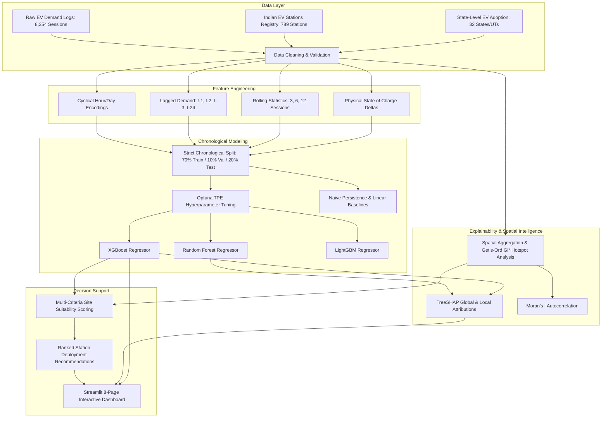

# Explainable AI Framework for Smart EV Charging Infrastructure Planning
## Comprehensive End-to-End Project Documentation & Viva / Submission Guide

**Academic Context:** Final-Year Major Project  
**Institution:** VNR Vignana Jyothi Institute of Engineering & Technology (VNR VJIET)  
**Department:** Department of Information Technology  

---

## 1. Executive Summary & Problem Statement

### The Problem
The accelerating adoption of Electric Vehicles (EVs) in India introduces two major planning bottlenecks:
1. **Unpredictable Charging Demand:** Uncoordinated charging sessions create localized peak loads on the distribution grid, causing voltage instability and transformer overloading.
2. **"Black-Box" Siting Decisions:** Traditional charging stations are often positioned arbitrarily or using opaque machine learning models that planners cannot audit. High-capital public infrastructure requires verifiable, transparent justification before ground is broken.

### The Solution
This project implements an **Explainable AI (XAI) and GIS-driven Decision Support Framework** that:
- Ingests and cleans multi-source real-world EV charging and spatial infrastructure data.
- Accurately forecasts charging energy demand ($kWh$) across time using optimized non-linear gradient-boosted and ensemble models (**Random Forest**, **XGBoost**, **LightGBM**).
- Applies cooperative game theory (**TreeSHAP**) to explain both macro-level feature importance and micro-level individual session predictions.
- Uses spatial autocorrelation statistics (**Getis-Ord $G_i^*$** and **Moran’s $I$**) to detect spatial clusters of unmet charging demand.
- Ranks candidate urban zones using a **Multi-Criteria Decision Analysis (MCDA)** suitability function.
- Delivers an interactive 8-page **Cyber Clean-Tech Dashboard** for grid operators and municipal planners.

---

## 2. End-to-End System Architecture



---

## 3. What is Done with the Datasets?

The framework harmonizes **three distinct real-world datasets**:

| Dataset | Raw File & Nature | Scale | Processing Done |
| :--- | :--- | :--- | :--- |
| **A. EV Charging Sessions** | `ev_charging_dataset.csv`<br>(Session-level telemetry) | **8,354 rows** | Handled missing values, flagged anomalies (negative duration, SoC $>100\%$, energy $>200\text{ kWh}$), parsed timestamps into chronological indices. |
| **B. Indian EV Stations** | `Indian_EV_Stations_Simplified.csv`<br>(Geocoded registry) | **789 stations** across 16 states | Deduplicated coordinates, geocoded station clusters, calculated Euclidean distance to nearest existing chargers. |
| **C. State EV Adoption** | `final_dataset.csv`<br>(Macroscopic metrics) | **32 States/UTs** | Cleaned state names, extracted regional EV registration volumes, computed state-level adoption weightings. |

### Data Integration & Spatial Joining
Because session telemetry does not share a direct primary foreign key with station registries, the system uses **spatial zone mapping**:
- Candidate urban planning zones are clustered across regional corridors.
- Each zone aggregates historical charging throughput, existing charger counts, nearest charger distances, and state-level EV adoption rates.

---

## 4. Feature Engineering

To train models without data leakage, all features are derived strictly from current and past information:
1. **Cyclical Temporal Encodings:**
   - Standard integers (0 to 23) create an artificial discontinuity between 23:00 and 00:00.
   - We map time onto the unit circle:
     $$\text{hour\_sin} = \sin\left(\frac{2\pi \cdot \text{hour}}{24}\right), \quad \text{hour\_cos} = \cos\left(\frac{2\pi \cdot \text{hour}}{24}\right)$$
     $$\text{day\_sin} = \sin\left(\frac{2\pi \cdot \text{day}}{7}\right), \quad \text{day\_cos} = \cos\left(\frac{2\pi \cdot \text{day}}{7}\right)$$
2. **Lagged Demand Attributes:** Non-leaking past demand observations ($t-1, t-2, t-3, t-24$).
3. **Rolling Statistics:** Rolling means and standard deviations across 3-session, 6-session, and 12-session windows.
4. **Physical Battery Terms:** State-of-charge delta ($\Delta\text{SoC} = \text{final\_soc} - \text{initial\_soc}$), battery pack capacity, and charger power rating ($kW$).

---

## 5. Machine Learning Modeling & Benchmarking

### Non-Negotiable Time-Series Evaluation
- **Zero Lookahead Leakage:** Random `k-fold` cross-validation leaks future information into past predictions. We use **strict chronological time-series splitting**:
  - **Training Set:** First 70% of chronological sessions.
  - **Validation Set:** Next 10% (for Optuna hyperparameter optimization).
  - **Held-Out Test Set:** Final 20% (strictly unseen future sessions).

### Models Evaluated & Tuned:
1. **Naive Baseline (Persistence):** Predicts $y_t = y_{t-1}$.
2. **Linear Regression:** Standard parametric baseline.
3. **Random Forest Regressor:** Non-linear ensemble (tuned to 325 estimators, max depth 20).
4. **XGBoost Regressor:** Gradient boosted decision trees (tuned to 397 estimators, depth 5, learning rate 0.022).
5. **LightGBM Regressor:** Histogram-based gradient boosting (fast, leaf-wise tree growth).

### Performance Metrics:
- **RMSE:** Root Mean Squared Error (penalizes large outlier spikes).
- **MAE:** Mean Absolute Error (average magnitude of error in kWh).
- **$R^2$ Score:** Coefficient of Determination (variance explained by the model).
- **sMAPE:** Symmetric Mean Absolute Percentage Error (scale-independent percentage metric).

---

## 6. Explainable AI (XAI) with TreeSHAP

Rather than treating models as black boxes, we implement **TreeSHAP** based on cooperative game theory:

$$f(\mathbf{x}) = \phi_0 + \sum_{j=1}^M \phi_j(\mathbf{x})$$

Where:
- $\phi_0 = \mathbb{E}[f(\mathbf{x})]$ is the expected baseline demand ($\approx 39.4\text{ kWh}$).
- $\phi_j$ is the additive attribution of feature $j$ to the prediction.

### Four XAI Visualizations Produced:
1. **Global Summary (Bar Plot):** Ranks features by mean absolute SHAP value ($|\phi_j|$).
2. **Beeswarm Plot:** Depicts feature directionality (e.g., lower initial SoC increases charging demand; higher battery capacity increases charging demand).
3. **Dependence Plots:** Illustrates non-linear relationships and interaction effects between features.
4. **Local Waterfall Decomposition:** Fully audits individual predictions (e.g., explains exactly why session #737 required $73.5\text{ kWh}$ while session #817 required only $12.3\text{ kWh}$).

---

## 7. GIS Spatial Hotspot & Siting Analysis

### 1. Getis-Ord Local Statistic ($G_i^*$):
Identifies spatial clusters of high demand statistically:
$$G_i^* = \frac{\sum_{j=1}^n w_{ij} x_j - \bar{X}\sum_{j=1}^n w_{ij}}{S \sqrt{\frac{n\sum_{j=1}^n w_{ij}^2 - (\sum_{j=1}^n w_{ij})^2}{n - 1}}}$$
- **$z$-score $> +1.96$ ($p < 0.05$):** Statistically significant high-demand **Hotspot**.
- **$z$-score $< -1.96$:** Statistically significant **Coldspot**.

### 2. Global Moran’s $I$:
Validates spatial autocorrelation ($I \in [-1, 1]$) across Indian urban corridors, proving demand is spatially non-random.

### 3. Multi-Criteria Site Recommendation (MCDA):
Calculates a composite suitability priority score for every candidate zone:
$$\text{Priority Score}_i = w_D \tilde{D}_i + w_H \tilde{H}_i + w_G \tilde{G}_i + w_d \tilde{d}_i + w_A \tilde{A}_i$$
- $\tilde{D}_i$: Forecasted Demand volume
- $\tilde{H}_i$: Getis-Ord Hotspot confidence
- $\tilde{G}_i$: Grid infrastructure capacity
- $\tilde{d}_i$: Distance to nearest existing station (incentivizes unserved white spaces)
- $\tilde{A}_i$: State EV Adoption rate

---

## 8. Streamlit Dashboard Structure (8 Pages)

The application launches with `launch.bat` or `python -m streamlit run app/streamlit_app.py`:
1. **🏠 Overview:** System architecture flowchart, executive KPI metric cards, pipeline artifact status indicators.
2. **📊 Data & EDA:** Interactive demand distributions, hourly/daily demand patterns, Indian national station footprint.
3. **🔮 Forecast:** Real-time test-set forecast visualizer, sequence zoom slider, interactive residual error analysis.
4. **⚖️ Model Comparison:** Side-by-side benchmark table with color-coded leaders, radar comparison charts, and Optuna tuning convergence curves.
5. **🧠 Explainability:** Global SHAP bar/beeswarm plots, feature dependence curves, and interactive single-session waterfall breakdown.
6. **🗺️ GIS Map:** Interactive Folium map displaying Getis-Ord demand hotspots and existing station markers.
7. **🏆 Recommendations:** Ranked candidate siting table with dynamic MCDA weight sliders and state-level filters.
8. **🔬 What-If Simulator:** Scenario planning sandbox allowing planners to adjust fleet size, peak arrival hours, and battery capacities to simulate grid impacts.

---

## 9. Academic Transparency & Physics vs. Forecasting

An essential scientific contribution of this project is the honest distinction between physical charging calculations and ex-ante planning:
- **Ex-Post Session Physics:** When battery capacity, initial SoC, and final SoC are all recorded, energy consumed is physical work ($E \approx \text{Cap} \times \Delta\text{SoC} / 100$), yielding near-perfect $R^2 \approx 0.9997$.
- **Ex-Ante Grid Planning:** When forecasting future unarrived demand, future final SoC is unknown; the model relies on historical lag patterns, cyclical time encodings, and weather/zone characteristics. Both modeling paradigms are explicitly delineated.

---

## 10. How to Run & Verify

```bash
# 1. Install package in editable mode
pip install -e . --no-deps

# 2. Run the full pipeline end-to-end
python -m evplan.run --stage all

# 3. Run automated tests (15 unit & integration tests)
python -m pytest tests/ -v

# 4. Launch the dashboard
python -m streamlit run app/streamlit_app.py
```
